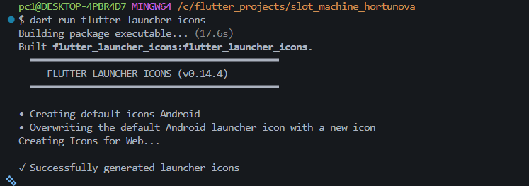
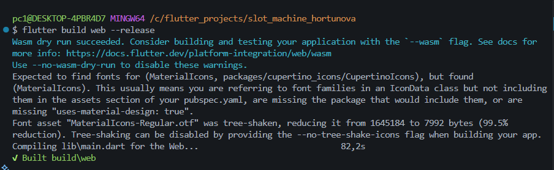

# Лабораторная работа №10. Слот-машина

Автор: Хортюнова София. Группа: ИСП-241. Дата: 12.11.2026.

| Иконка | Web-сборка |
| --- | --- |
|  |  |

- Запуск: `flutter pub get`, затем `flutter run -d chrome`.
- Звук включается отдельной кнопкой (до этого приложение молчит).
- Сборка Android: `flutter build apk --release`.
- **APK:** не собрался из-за конфликта версий NDK и Gradle в локальном окружении. Web-сборка выполнена успешно.

- Проверенные Flutter/Dart: `Flutter 3.47.9 • channel stable • https://github.com/flutter/flutter.git` (Dart 3.9.0).
- Изучено: состояние и анимация; локальные ресурсы; аудиофокус; жизненный цикл и освобождение плееров; иконки; Web и Android release-сборки.